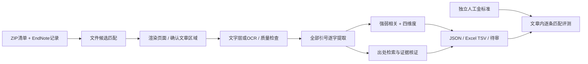

# AcuExactAgent

**PDF + 研究 prompt → 古籍引文、强弱相关、维度与理由。** 中文工作台可直接导入 PDF，接入 OpenAI/GPT、Anthropic/Claude、MiniMax 或自定义 OpenAI-compatible API。智能体规划文章范围、读取选区、逐字提取、模型查漏与修复、批量分类并校验结果。保留页码、原页预览和出处证据。另提供无需密钥的离线样例、人工圈区批处理与金标准评测。

> 数据状态：实际检查 `OneDrive_1_10-29-2026.zip`，包含 **5,232 份 PDF**，未包含人工金标准或 EndNote 记录。当前仓库的演示金标准是明确标记的**合成测试夹具**，不能代表真实文献准确率。本项目未声称已完成 5,232 份文献的全文提取或人工金标准验证。详见 [数据审计](docs/dataset-audit.md)。

## 3 分钟运行演示

需要 Python 3.10+（建议 3.12）。Windows、macOS、Linux 均可运行。

```bash
git clone https://github.com/psknlr/AcuExactAgent.git
cd AcuExactAgent
python -m venv .venv
```

Windows PowerShell：

```powershell
.\.venv\Scripts\Activate.ps1
python -m pip install -e .
python -m acuexact demo --out outputs/demo
python -m acuexact serve --port 8765
```

macOS / Linux：

```bash
source .venv/bin/activate
python -m pip install -e .
python -m acuexact demo --out outputs/demo
python -m acuexact serve --port 8765
```

浏览器打开 **http://127.0.0.1:8765**。导入 PDF、填写任务 prompt、选择供应商和模型、输入 API Key 后点击运行。扫描件启用视觉模型；MiniMax 文字模型可搭配独立 GPT/Claude 视觉配置。含多篇文章时填写 EndNote 对应标题。结果可筛选、核对原页与矩形证据、复制到 Excel、下载 TSV / JSON。

“离线合成样例”无需密钥，包含病名排除、弱相关短词保留、缺失出处、重复及跨页引文、同页邻文隔离。它使用虚构《演示医籍》，不会冒充真实 API 结果。详见 [PDF 智能体与 API 接入](docs/pdf-agent.md)。

也可使用 Docker（离线样例无需模型；PDF 智能体需 API Key）：

```bash
docker build -t acuexact .
docker run --rm -p 127.0.0.1:8765:8765 acuexact
```

## 工作流程



PDF 智能体按“规划 → 工具执行 → 查漏 → 受限修复 → 分类 → 校验”运行。模型可选择区域和提出补提候选，本地程序验证候选是否逐字存在；分类不允许修改、删除原文。视觉转录与自动边界始终需要复核。离线规则用于可复现基线，不能替代模型或专家分类。

### 规则与输出约束

- 默认只按精确名单排除 `肩痛`、`肩不举`、`肩不舉`；不使用“内容相关性”筛除引文。其他病名可通过 `--disease-names names.json` 明确配置。
- 所有平衡的 `“”`、`「」`、`『』` 引号内容均保留，包括现代术语、短语和弱相关内容。嵌套引文保存在外层引文内；重复出现不去重。
- 未闭合引号单独告警；若后面有独立完整引文，保留并标记待审。没有引文不会被视为文字识别成功。
- `text_raw` 保留区域拼接的原始内容；`text` 只去行折行符及外侧空白，不改标点、错字、异体字或简繁。`char_start/end`、页码、区域 bbox 可追溯到证据。矩形证据为选定区域级，并非逐字坐标。
- `source_explicit` 仅保存文章局部语法明确提及的书名/篇章，缺失为 `null`，绝不凭常识补写。
- `source_candidates` 保存检索候选；`source_enriched` 保存独立核证结果。两者均不会覆盖 `source_explicit`。无法核证则留空待查。
- 四维度固定为：肩痛病因病机、肩痛辨证、肩痛取穴、肩痛针刺手法与操作原则。每条保留类别、维度、理由、方法及待审状态。

## 用自己的资料复现

### 1. 清点压缩包并导入 EndNote

原始资料放在本地，例如 `data/private/`，不需要上传 GitHub。

```bash
python -m acuexact inventory --zip "OneDrive_1_10-29-2026.zip" --out outputs/inventory.json
python -m acuexact endnote --input selected-records.xml --out outputs/records.json
python -m acuexact plan --records outputs/records.json --inventory outputs/inventory.json --out outputs/article-plans.json
```

支持 EndNote XML、RIS、EndNote Export TXT；`.enl/.enlx` 请在 EndNote 中导出为 XML。记录 ID 是文章身份，不能由 PDF 的页码或文件序号替代。匹配计划只提供文件候选，不把文件名相似当作已确认的文章边界。

按清单中的**完整成员路径**选择性解压，避免一次解压整个大包：

```bash
python -m acuexact unpack --zip "OneDrive_1_10-29-2026.zip" --member "组名/目标.pdf" --out data/private
```

### 2. 确认目标文章边界

```bash
python -m acuexact inspect --pdf data/private/paper.pdf --title "EndNote中的标题" --out outputs/inspection
```

检查输出 PNG 与 `inspection.json`：核对标题、作者、续页、同页上下篇和分隔线。横线只作为提示，扫描图片中的横线未必被检测出来。复制 [文章清单模板](examples/article-manifest.json)，填入检查报告的 `pdf_sha256`，指定按阅读顺序排列的区域，确认后设置 `boundary_status: "approved"` 并填写 `reviewer`。

`bbox` 为 PDF 点坐标 `[左, 上, 右, 下]`，原点在页面左上角，页码从 1 开始。双栏分别列左栏、右栏；同页上下两篇只选目标文章的区域。跨页引文按区域顺序拼接。不要用整页矩形覆盖其他文章。

未确认、哈希不符、区域重叠或文字层为空时，系统拒绝静默退回整份 PDF。人工审批边界是当前可靠性门槛；尚未实现无需复核的通用自动版面分篇。

### 3. 提取、分类、导出

```bash
python -m acuexact extract --pdf data/private/paper.pdf --manifest article.json --out outputs/paper
python -m acuexact batch --manifest examples/batch.json --out outputs/batch
```

`batch.json` 是 `{pdf, manifest}` 列表，路径相对该文件；逐篇保存结果并汇总，失败项记录错误并返回非零退出码，不把失败当作空结果。

输出 `result.json` 保留证据、告警、排除记录和审计；`quotes.tsv` 为 UTF-8 BOM，可在 Excel 打开或复制粘贴。书名/篇章与补全书名/篇章分别成列。导出防止单元格内容被误识别为 Excel 公式，原始 JSON 不改变。

### 4. OCR 与人工校对

对扫描件或文字层引号缺失可强制 OCR：

```bash
python -m pip install -e ".[ocr]"
python -m acuexact extract --pdf paper.pdf --manifest article.json --ocr --out outputs/ocr
```

需要另装 Tesseract 及 `chi_sim`、`chi_tra` 语言数据。OCR 是待校对转写，不能保证古文字形正确；当前环境未运行真实 Tesseract OCR 性能测试。`--ocr` 对全部选定区域使用 OCR。已有文字层也会检测私用区字符、控制字符、CID 缺字和引号不平衡。

人工校对可在对应区域添加 `verified_text` 与 `text_reviewer`。结果保留 `pdf_text_original`、校对后文字与审核人，禁止不留记录地“修正”古文。页眉、脚注和邻文应在区域划分时剔除。

### 5. 可选模型与出处检索

以下是旧版人工圈区 `extract` 的可选分类接口：`--llm` 调用 OpenAI Responses API，使用 `OPENAI_API_KEY` 和 `OPENAI_MODEL`。新版直接输入 PDF 的 `agent` 命令支持多供应商、自定义 prompt 与独立视觉模型，见 [使用说明](docs/pdf-agent.md)。`.env.example` 仅作变量说明，程序不会自动加载 `.env`。

```bash
python -m acuexact extract --pdf paper.pdf --manifest article.json --llm --out outputs/llm
python -m acuexact lookup --input outputs/paper/result.json --out outputs/looked-up
```

分类模型接收引文，使用结构化 JSON 输出，不拥有改变引文或补出处的权限。`lookup`（或 `extract --lookup`）向中文维基文库发送缺出处引文的查询，每条最多 3 次请求，取得正文后才做去空白的全文精确比对；不是只信搜索摘要。候选书篇由页面标题解析，仍需核对版本和章节。网络失败、简繁/标点差异或覆盖不足时保留待查，不伪造结论。

核证资料可保存为本地 catalog，使用 `extract --catalog catalog.json`。核证字段要求见 [架构与数据约定](docs/architecture.md)。本地演示不自动调用模型或外网。当前未用 API 密钥进行真实模型效果测试。

## 人工金标准评测

建议按 [TSV模板](examples/gold-template.tsv) 每次出现一行，保留文章 ID、完整原文、原文明示书名/篇章。不要把后续查到的出处写进“原文明示”列。也支持 `.xlsx`。

```bash
python -m acuexact gold-import --input gold.xlsx --article-column 文章ID --quote-column 古籍条文 --book-column 原文明示书名 --chapter-column 原文明示篇章 --out outputs/gold.json
python -m acuexact evaluate --pred outputs/batch/result.json --gold outputs/gold.json --out outputs/evaluation.json
python -m unittest discover -s tests -v
```

提供逐字 precision / recall / F1、独立的忽略空白指标、漏提/多提清单、字符近似诊断、无出处误加出处及出处错误。近似匹配不会计作正确。重复引文按文章内出现顺序匹配，因此 gold 应维持原文顺序。部分未标注的出处字段不参与评分；空 gold 的指标为 `null`。有人工相关性标签时，另报已匹配引文上的分类混淆与维度 micro-F1，不能把条件分类准确率当作端到端指标。

真实评测前应按文章划分开发/测试集，并按重复文献簇隔离，冻结规则、提示词和模型后再评估；gold 不进入推理。当前只完成工程回归与真实 PDF 解析抽样检查，真实 gold 结果待补。

## 目录

```text
acuexact/                 Agent 阶段、CLI、服务和前端
  data/                   明确标注的合成样例与测试 gold
examples/                 EndNote、边界、批处理和 gold 模板
tests/                    提取、出处、边界、安全与评测回归
docs/                     架构、数据审计、复现验证记录
outputs/                  本地运行结果（Git 忽略）
data/private/             本地原始资料（Git 忽略）
```

边界限制：规则不能完美处理复杂版面、跨句出处归属或所有古汉语语义；缺失标点不能靠模型编造补齐。当前原文明示出处提取是保守局部规则。研究用分类与文献整理结果需人工复核，不构成治疗建议。
